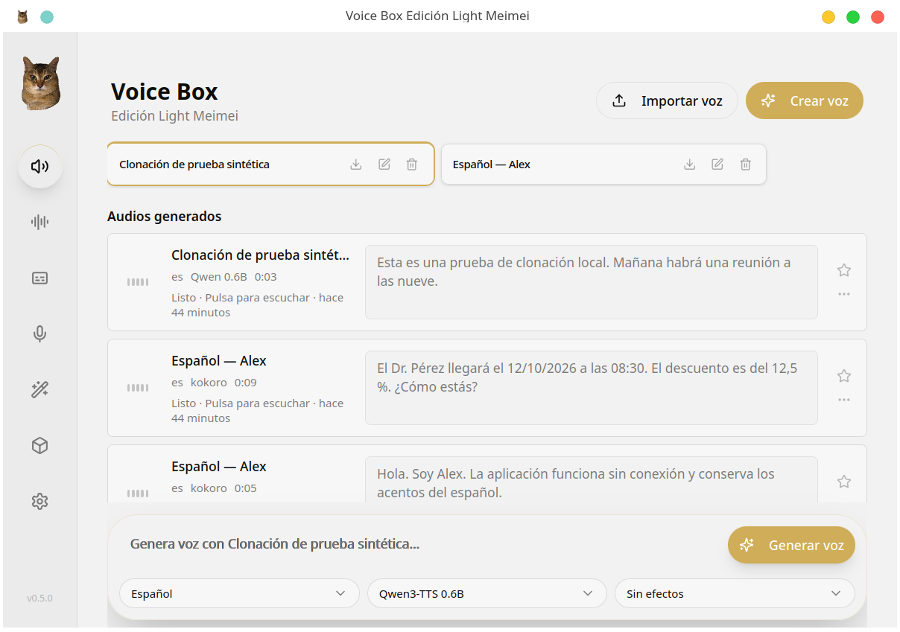
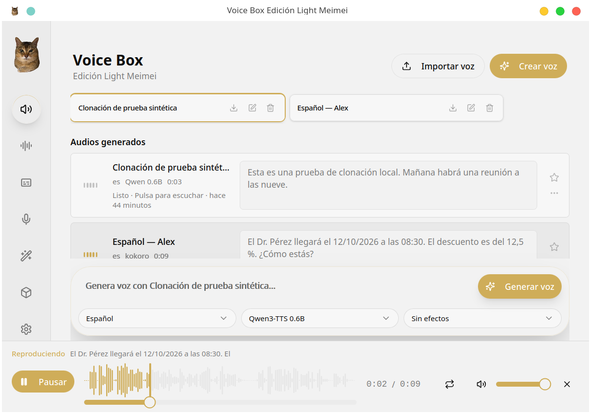
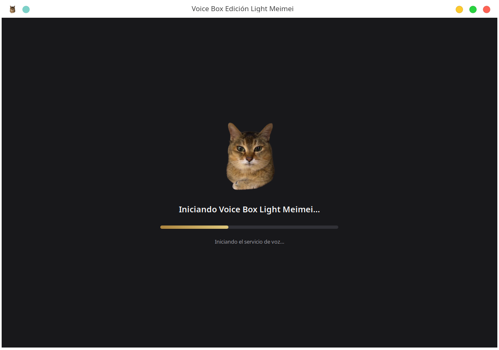
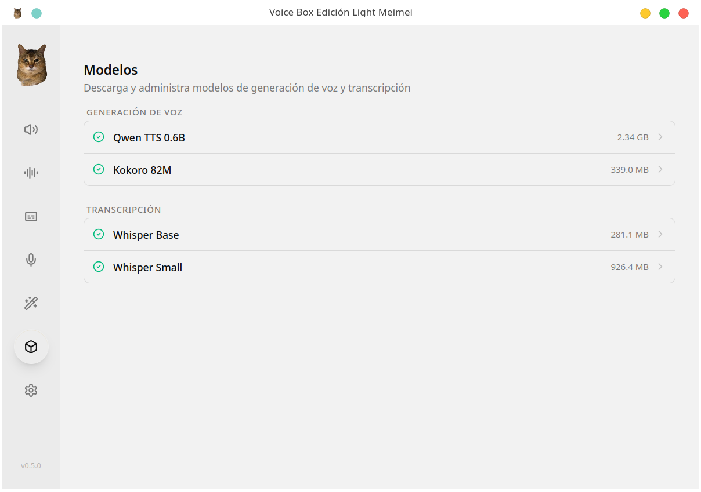

# Voice Box Edición Light Meimei

**Voicebox, creado por [Jamie Pine](https://github.com/jamiepine) y sus colaboradores.**

**Light Meimei es la adaptación de [segueldev](https://github.com/segueldev) como aplicación Linux optimizada para equipos modestos**, basada en [Voicebox v0.5.0](https://github.com/jamiepine/voicebox/tree/v0.5.0).

Aplicación de escritorio en español para generar y clonar voces de forma local. El lanzador abre una ventana propia y gestiona automáticamente el servicio interno; no hay que abrir el navegador, escribir localhost ni mantener una terminal. No es una versión oficial del proyecto original.

## Así se ve la aplicación Linux

Capturas reales de Light Meimei en KDE Plasma X11, con voces y audios de demostración. La ventana pertenece a la aplicación: se abre desde el menú y prepara el servicio automáticamente.

**Una aplicación lista para abrir.** Ventana propia, logo Meimei, interfaz en español y acceso directo a generación y clonación local. [Descargar la edición Linux offline](https://github.com/segueldev/voicebox-light-meimei/releases/tag/v0.5.0-light-meimei.1).

### Historial, escritura y reproducción con su propio espacio

Los controles de reproducción quedan debajo de la escritura y el historial conserva una zona para desplazarse. El estado y la onda del audio permiten ver qué se está reproduciendo; las acciones de los perfiles están alineadas.

### Inicio automático con logo y progreso

La bienvenida muestra las etapas de arranque con una barra animada y desaparece cuando la interfaz está lista. El usuario no tiene que gestionar localhost ni dejar una terminal abierta.

### Modelos seleccionados para equipos modestos

Kokoro 82M, Qwen3-TTS 0.6B y Whisper Base/Small: un conjunto local limitado a los modelos del perfil ligero. La voz masculina Alex permite empezar en español; la clonación utiliza una referencia de voz propia. Estas funciones de voz proceden de Voicebox; su selección, configuración y presentación forman parte de esta adaptación.

## ¿Por qué elegir Light Meimei?

**Porque en Linux se abre como una aplicación desde el menú y prepara todo automáticamente.** No tienes que iniciar el servicio a mano, dejar una terminal abierta, abrir un navegador ni escribir una dirección localhost cada vez. Al cerrar la ventana también se cierra el servicio que inició la aplicación.

La comparación es con la instalación manual de **Voicebox v0.5.0 en Linux**, que fue la base de esta adaptación. El proyecto original ya cuenta con aplicaciones de escritorio para otras plataformas; Light Meimei aporta esta integración y configuración específica para Linux.

| Mejora de esta edición | Qué cambia al usarla |
| --- | --- |
| Ventana propia y lanzador con icono | Se abre desde el menú KDE como una aplicación habitual. |
| Inicio con logo y barra animada | Ves qué se está preparando; la bienvenida termina cuando la interfaz está lista. |
| Distribución offline completa | El paquete incluye los modelos y dependencias necesarios. Tras descargar el paquete completo, no necesita descargar modelos al instalar o generar. |
| Perfil de consumo reducido | Kokoro 82M para voz cotidiana, Qwen 0.6B para clonación y Whisper Base/Small para transcribir; se evita ofrecer modelos pesados no comprobados en el equipo objetivo. |
| Gestión de memoria | Las tareas pesadas se ejecutan de una en una y el modelo anterior se libera al cambiar de motor. |
| Español y Alex | Interfaz traducida y una voz masculina predefinida en español para empezar a escribir sin crear un clon. |
| Progreso de generación claro | Estados de cola, carga, generación y reconexión, con tiempo transcurrido; no parece que la aplicación esté bloqueada. |
| Reproducción comprensible | Indica si el audio está listo, reproduciéndose, pausado o terminado. Permite reproducción automática cuando está activada y ofrece controles visibles. |
| Historial que se puede recorrer | La caja de escritura queda debajo de los audios y reserva espacio para el reproductor. El gesto vertical sobre la zona de voces desplaza el historial. |
| Acciones alineadas | Editar, exportar y eliminar quedan en la misma posición aunque cambie la longitud de las descripciones. |
| Recuperación de errores | Se recupera el progreso si se interrumpe su conexión, se evita duplicar peticiones y se conserva el texto cuando falla el envío. |
| Texto español más predecible | Normaliza fechas, horas, números, porcentajes y abreviaturas antes de sintetizar; el texto original permanece en el historial. |
| Interfaz ajustada a esta ventana | Se ocultan funciones exclusivas de otros entornos que no funcionan en esta integración Linux. |

**La generación, la clonación, los perfiles y el historial proceden de Voicebox.** La aportación de Light Meimei es su integración como aplicación Linux, el empaquetado, los valores ligeros y las mejoras de uso enumeradas aquí. El detalle técnico y las correcciones están en [CHANGELOG-LIGHT.md](CHANGELOG-LIGHT.md).

Es una opción pensada para equipos modestos como el de referencia de segueldev: Ryzen 5, 8 GB de RAM y RTX 2050 con 4 GB de VRAM. “Light” se refiere al uso de modelos ligeros y a la configuración; el instalador offline es grande porque lleva los archivos de IA incluidos. No garantiza que cualquier equipo pueda ejecutar clonación con rapidez ni que toda pronunciación sea perfecta.

## Proyecto original y adaptación

El proyecto original es [jamiepine/voicebox](https://github.com/jamiepine/voicebox), creado por Jamie Pine junto con sus colaboradores. Se conserva su licencia MIT, su aviso de copyright y el historial de la versión utilizada.

segueldev adaptó esa base a sus necesidades: convertirla en una aplicación Linux fácil de abrir, configurar modelos ligeros para un equipo de 8 GB de RAM y RTX 2050 de 4 GB, ponerla en español, mejorar los estados de generación y reproducción y corregir los problemas de interfaz encontrados durante el uso. El nombre y logo Meimei identifican esta edición comunitaria.

Esta adaptación no es una publicación oficial de Jamie Pine. Las mejoras se documentan para poder compartirlas y proponer contribuciones concretas al repositorio original.

## Instalación sin conexión

La distribución completa incluye Python, dependencias, interfaz, modelos y un instalador para el usuario. Descarga **el instalador, el manifiesto y todas las partes** de la misma versión en una carpeta. Ejecuta `bash instalar-meimei.run`. El instalador verifica las partes y muestra su progreso; no solicita privilegios de administrador ni descarga paquetes. Después encontrarás **Voice Box Edición Light Meimei** en el menú de aplicaciones.

El paquete es grande porque incluye los modelos y las bibliotecas de IA. GitHub limita cada archivo de una release a menos de 2 GiB; por eso se distribuye por partes. **El repositorio de código por sí solo no es el instalador offline.**

Sistema objetivo inicial: Linux x86_64, Arch/EndeavourOS con sesión gráfica y glibc compatible con el equipo de construcción. No se promete compatibilidad con todas las distribuciones. La GPU requiere el controlador NVIDIA instalado en el sistema; el controlador no se incluye. Se mantienen los requisitos normales de una sesión Linux (glibc, D-Bus, audio, fuentes, bubblewrap para la protección de WebKit).

La generación, clonación y transcripción usan archivos locales. Los enlaces a GitHub y cualquier actualización futura necesitan internet si decides abrirlos. No se incluye telemetría adicional. El servicio escucha solamente en la dirección local del equipo.

## Modelos incluidos

- Kokoro 82M: voz masculina en español **Alex**, ligera y seleccionada inicialmente.
- Qwen3-TTS 0.6B Base: clonación con una grabación de referencia propia.
- Whisper Base y Small: transcripción local; Small priorizado por su precisión en español.

La edición limita la interfaz a estos modelos. No incluye modelos de 1.7B, Whisper Medium/Large ni motores adicionales que no se verificaron en el equipo objetivo. No incluye grabaciones, historial, referencias de voz ni bases de datos del desarrollador.

## Equipo de referencia

| Componente | Configuración comprobada |
| --- | --- |
| Sistema | EndeavourOS x86_64, KDE Plasma, KWin X11 |
| Equipo | ASUS TUF Gaming A15 FA506NF |
| CPU | AMD Ryzen 5 7535HS, 6 núcleos / 12 hilos |
| RAM disponible para el sistema | 7.08 GiB (equipo de 8 GB) |
| GPU | NVIDIA RTX 2050, 4 GiB de VRAM; AMD Radeon 680M |
| Intercambio | 19.54 GiB |
| Disco | SSD de 474.94 GiB, btrfs |
| Pantalla | 1920 × 1080, escala 125 % |

Se ejecuta una tarea pesada a la vez y se libera el modelo anterior al cambiar de motor. Kokoro es la opción cotidiana de menor consumo. La clonación tarda más y puede usar intercambio si otras aplicaciones ocupan la RAM. La CPU sirve como alternativa, con tiempos mayores. El instalador comprueba el disco; el controlador GPU sigue siendo responsabilidad del sistema operativo.

Las mejoras de pronunciación normalizan números, fechas, horas y abreviaturas en español. Ningún modelo garantiza pronunciación perfecta: revisa el audio final, especialmente nombres propios, textos ambiguos y referencias con ruido. Una referencia clara y un texto bien puntuado mejoran los resultados.

## Cambios, créditos y desarrollo

Consulta [los cambios de Light Meimei](CHANGELOG-LIGHT.md), [los créditos](CREDITS.md), [la construcción offline](linux-light/BUILD.md) y [las propuestas para upstream](UPSTREAM-CONTRIBUTIONS.md). Conservamos la [licencia MIT original](LICENSE) y los [avisos de terceros](linux-light/THIRD-PARTY.md). El README original está en [docs/upstream](docs/upstream/README-v0.5.0.md).
